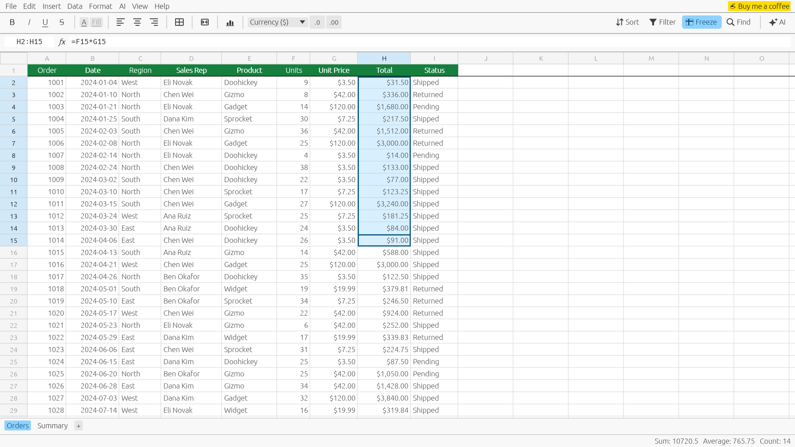
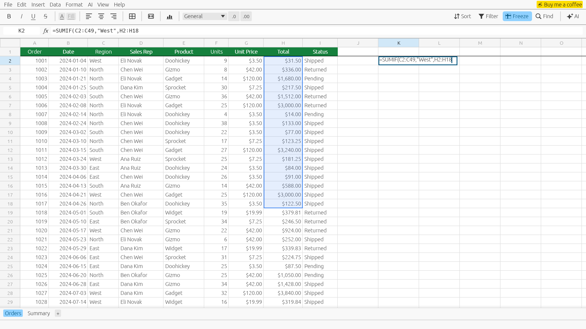
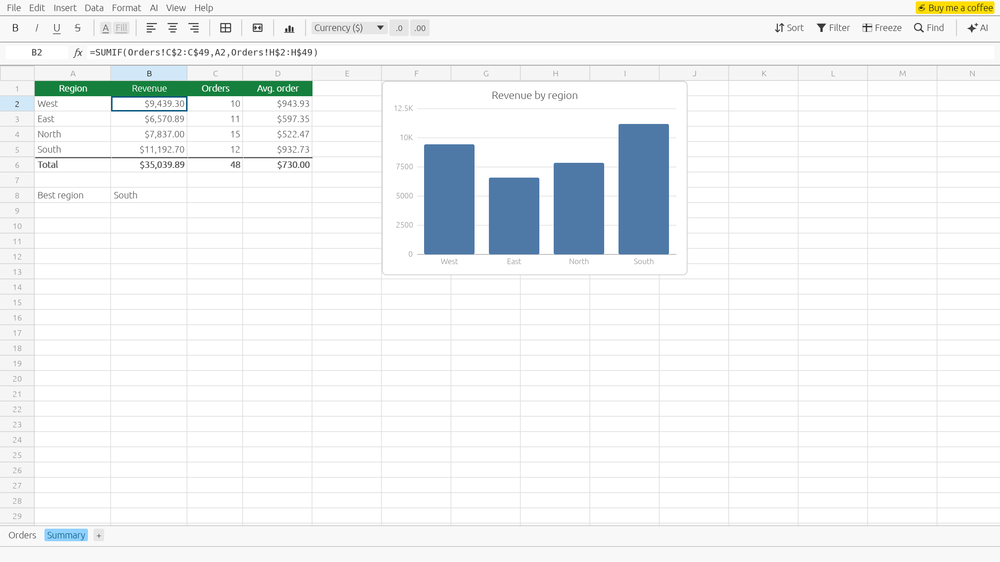
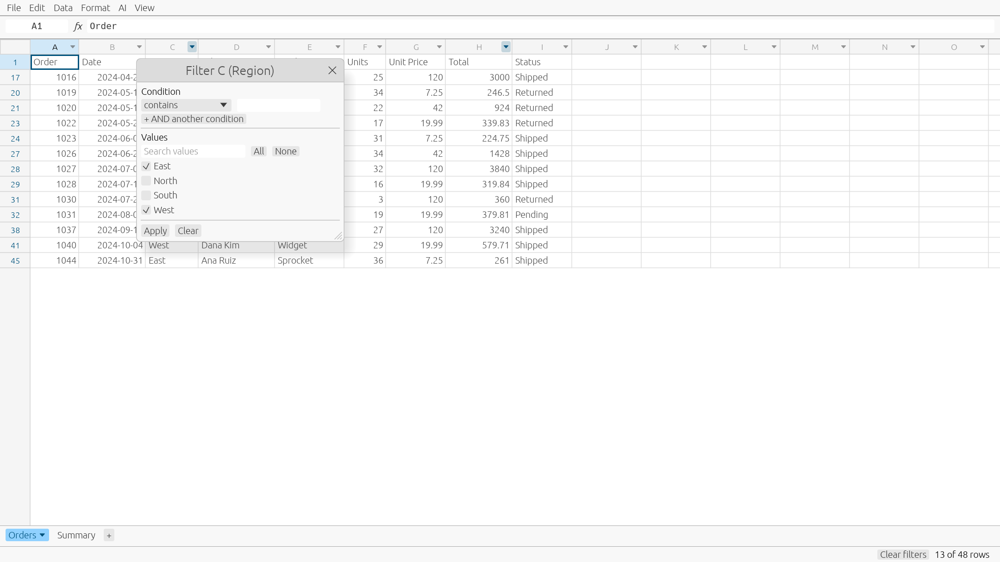
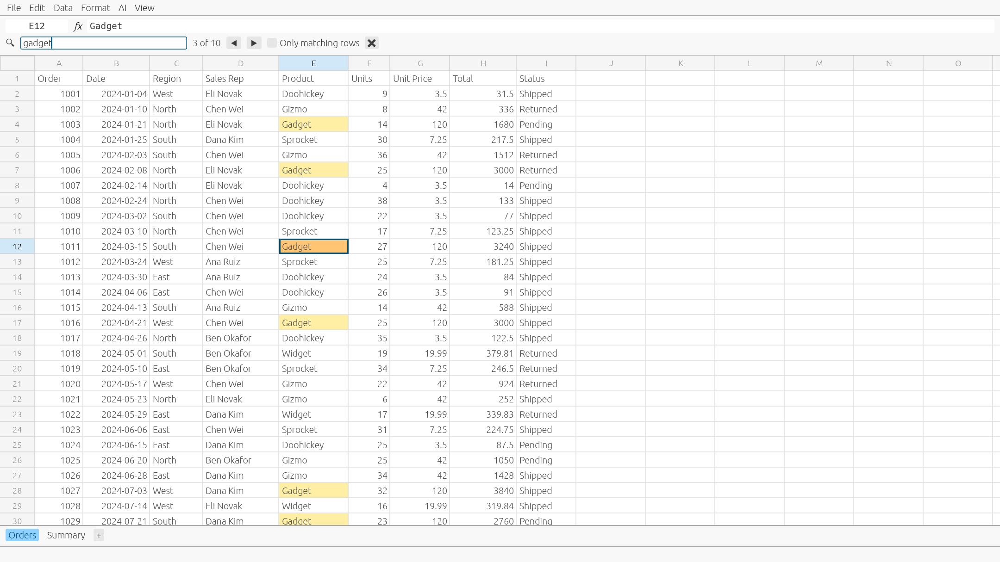
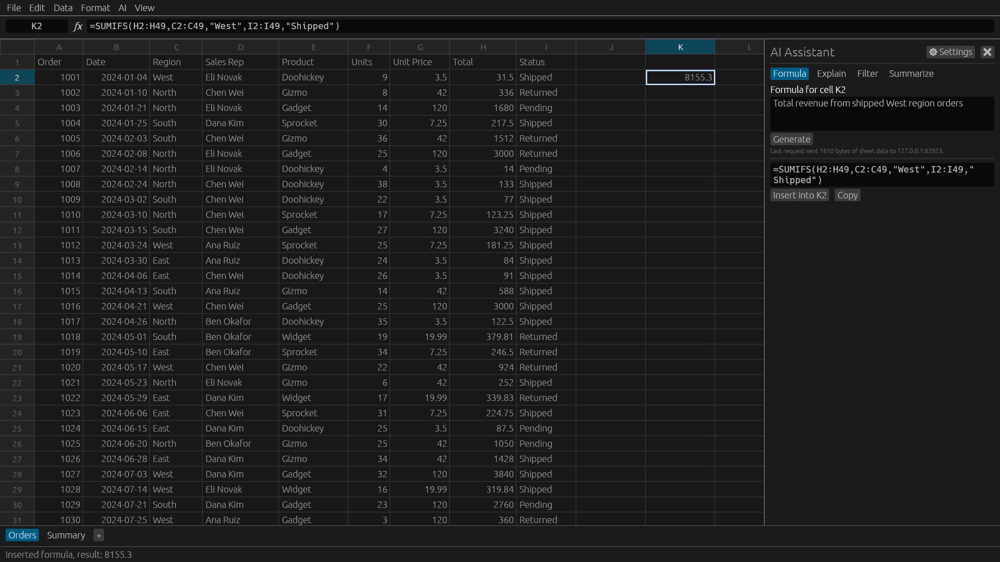
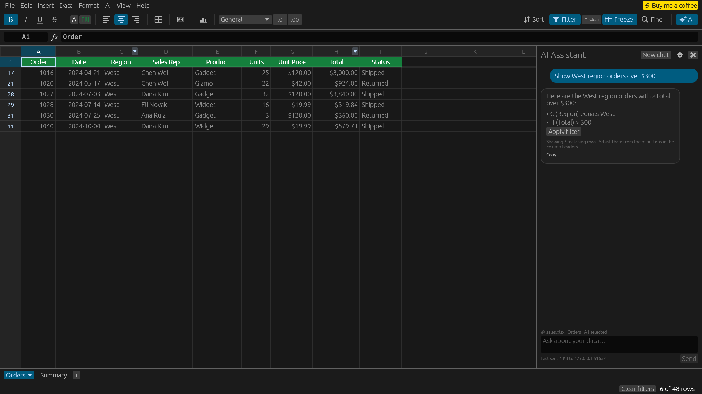
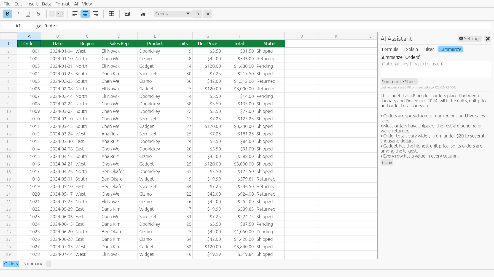
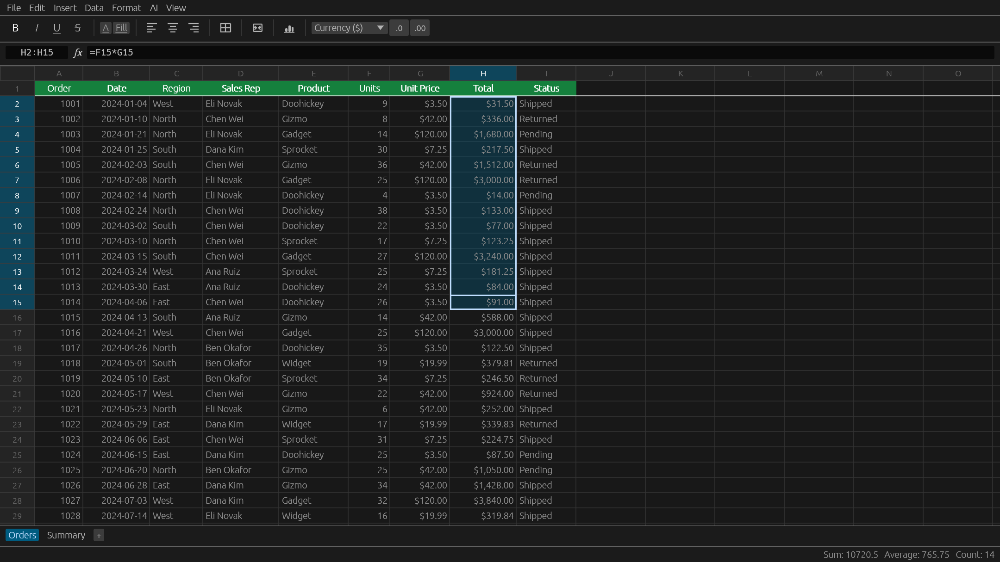

<div align="center">


# LiteSheet

**A lightweight, fast, and privacy-focused spreadsheet for macOS, written in Rust.**

Excel-compatible formulas, filtering and sorting, smooth scrolling through hundreds of thousands of rows, and AI help that runs on *your* API key.

**[Website](https://theabhishekin.github.io/litesheet/)** · **[Download for Mac](https://github.com/TheAbhishekIN/litesheet/releases/latest/download/LiteSheet-macos.zip)** · **[Contributing](CONTRIBUTING.md)**

[](https://github.com/TheAbhishekIN/litesheet/actions/workflows/ci.yml)
[](#license)




</div>

## Why LiteSheet?

- **Small and fast.** A single ~25 MB native app. It opens a 200,000-row file in about 1.5 s and scrolls at well under a millisecond per frame.
- **Compatible.** Opens and saves `.xlsx` and `.csv`, with 400+ Excel functions recalculated as you type.
- **Private by default.** No accounts, telemetry or cloud. The only network requests are the AI requests you start, and they go straight to the provider you choose.

## Contents

- [Features](#features)
- [Screenshots](#screenshots)
- [Install](#install)
- [Using LiteSheet](#using-litesheet)
- [AI (Bring Your Own Key)](#ai-bring-your-own-key)
- [Privacy](#privacy)
- [Performance](#performance)
- [Roadmap and limitations](#roadmap-and-limitations)
- [Contributing](#contributing)
- [License](#license)

## Features

### Files
- Open `.xlsx`, `.xlsm`, `.xls`, `.ods`, `.csv` and `.tsv` files
- Save as `.xlsx` (all sheets) or `.csv` (current sheet), and export any sheet as CSV
- Formulas, dates, percentages and column widths are kept when you save
- Open files from the File menu, by dragging them onto the window, or from the command line
- Unsaved-changes prompt when you create, open or quit; a `•` in the title bar marks unsaved changes

### Grid and editing
- Virtualized grid: only visible cells are drawn, so very large sheets stay smooth
- Multiple sheets with tabs you can add, rename and delete
- Edit in the cell or in the formula bar; type to replace, **Return**/**F2**/double-click to edit
- **Return**/**Tab** commit and move (hold **Shift** to go back), **Esc** cancels
- Name box: jump to a cell (`B12`), a range (`A1:C20`) or a sheet by name
- Mouse and keyboard selection, whole-row/column selection, drag past the edge to auto-scroll
- Resize columns by dragging; double-click a column border to autofit
- Cut, copy and paste as tab-separated text, compatible with Excel, Numbers and Google Sheets
- Fill down (**⌘D**) and fill right (**⌘R**)
- Insert and delete rows and columns from the Edit menu or by right-clicking a header; formulas, ranges and column widths follow
- 200-step undo and redo for every change, including paste, fill and sort
- Live Sum, Average and Count of the selection in the status bar
- Light and dark themes, and zoom with **⌘+** / **⌘−**

### Styling
- Formatting toolbar: **bold**, *italic*, underline and strikethrough (**⌘B**, **⌘I**, **⌘U**), text and fill colours (palette or custom), left/center/right alignment, borders (all, outside, single sides, none), number format and decimals
- Text on a coloured fill switches between dark and light automatically to stay readable
- **Merge & Center**, Merge Cells and Unmerge (toolbar or Format menu); a merged range behaves as one cell for selection, arrow keys and editing
- Styles are kept when you type over a cell, copy, fill or sort; **Delete** keeps them, *Edit → Clear Formats* and *Clear All* remove them
- Fonts, colours (including Excel theme colours), fills, borders, alignment, number formats, merged cells and column widths are read from `.xlsx` files and written back on save

### Formulas
- 400+ Excel-compatible functions, powered by [formualizer](https://crates.io/crates/formualizer): `SUM`, `SUMIFS`, `VLOOKUP`, `INDEX`/`MATCH`, `IF`, `TEXT`, `ROUND` and many more
- Dependent cells recalculate automatically
- References across sheets (`=Summary!B2`, `='My Sheet'!A1`)
- Point mode: while typing a formula, click or drag over cells to insert `A1` or `A1:B5`
- Relative references adjust on copy/paste, fill and sort; `$A$1` stays fixed
- Missing closing brackets are added for you
- Excel error values: `#DIV/0!`, `#N/A`, `#NAME?`, `#REF!`, `#VALUE!` …

### Data
- **Sort** A→Z or Z→A by any column, for the selected rows or the whole sheet (row 1 stays as the header)
- **Column filters:**
  - conditions: equals, contains, starts with, `>`, `≥`, `<`, `≤`, is empty, …
  - two conditions combined with AND
  - a searchable checklist of the column's values
- Filtered rows are only hidden, never deleted; arrow keys skip them, and the status bar shows how many rows are visible
- **Find** (**⌘F**) highlights every match and steps through them; tick "Only matching rows" to show just those rows
- **Number formats:** General, Number (`1,234.50`), Currency (`$ € £ ¥ ₹`), Percent, Scientific, Date, Time, Date & Time and Text, with Increase/Decrease Decimal
- Typing is recognized: `2024-05-01` is a date, `14:30` or `2:30 PM` a time, `15%` a percentage, `$1,250.50` currency and `1,234` a number with separators; a leading `'` keeps text as text
- Formats stay on empty cells, so you can format a column before typing; **Delete** clears values but keeps formats

### AI (Bring Your Own Key)
- **Generate formulas** from plain English, written for the selected cell using your column headers
- **Explain** a selected range: what it contains, patterns, outliers
- **Filter in plain English**, turned into normal column filters you can inspect and edit
- **Summarize** a sheet: an overview with key figures
- Works with any OpenAI-compatible API, including local models through Ollama or LM Studio
- The API key is stored in the macOS Keychain

## Screenshots

| | |
|---|---|
| **Build formulas by pointing at cells**<br> | **Several sheets, linked by formulas**<br> |
| **Column filters**<br> | **Find**<br> |
| **AI: generate a formula**<br> | **AI: filter in plain English**<br> |
| **AI: summarize a sheet**<br> | **Dark mode**<br> |

> The screenshots are rendered from the real app by `scripts/generate-docs-assets.sh`. The AI screenshots use a stand-in for the AI provider, so their text is illustrative.

## Install

LiteSheet currently targets **macOS 11 or later** on Apple Silicon and Intel.

### Download

**[⬇ Download LiteSheet for Mac](https://github.com/TheAbhishekIN/litesheet/releases/latest/download/LiteSheet-macos.zip)**: one universal app for Apple Silicon and Intel.

1. Unzip it and drag **LiteSheet.app** into Applications.
2. Open it. LiteSheet isn't notarized by Apple yet, so the first time macOS says *"LiteSheet" Not Opened*. Click **Done**, then allow it once using either option:
   - **System Settings → Privacy & Security**: scroll down to *"LiteSheet" was blocked…*, click **Open Anyway**, then confirm with your password or Touch ID; or
   - run this in Terminal:
     ```bash
     xattr -dr com.apple.quarantine /Applications/LiteSheet.app
     ```
3. From then on LiteSheet opens normally.

> On macOS 14 and earlier you can also right-click the app and choose **Open**. That shortcut no longer works on macOS 15 and later.

Older versions are on the [Releases page](https://github.com/TheAbhishekIN/litesheet/releases).

### Build from source

You'll need [Rust](https://rustup.rs/) 1.95 or newer and the Xcode Command Line Tools:

```bash
xcode-select --install
```

```bash
git clone https://github.com/TheAbhishekIN/litesheet.git
cd litesheet
cargo run --release
```

Open a file at startup:

```bash
cargo run --release -- samples/sales.xlsx
```

Build a double-clickable `dist/LiteSheet.app` (add `--universal` for Apple Silicon + Intel):

```bash
./scripts/bundle-macos.sh
```

> **Linux and Windows:** the code is cross-platform (egui, calamine and keyring all support them), but these builds aren't tested yet. Reports and fixes are welcome.

## Using LiteSheet

Try it on the bundled `samples/sales.xlsx`: an order list plus a summary sheet built with `SUMIF`, `COUNTIF` and `INDEX`/`MATCH`.

### Keyboard shortcuts

| Action | Shortcut |
|---|---|
| New / Open / Save / Save As | ⌘N / ⌘O / ⌘S / ⇧⌘S |
| Undo / Redo | ⌘Z / ⇧⌘Z (or ⌘Y) |
| Cut / Copy / Paste | ⌘X / ⌘C / ⌘V |
| Edit cell | Return, F2 or double-click |
| Commit and move down / right | Return / Tab (⇧ to reverse) |
| Cancel edit | Esc |
| Clear selection | Delete |
| Bold / Italic / Underline | ⌘B / ⌘I / ⌘U |
| Fill down / right | ⌘D / ⌘R |
| Select all | ⌘A |
| Jump to the edge of the data | ⌘ + arrow (⇧ to extend) |
| Find | ⌘F (Return / ⇧Return for next / previous) |
| Toggle filter buttons | ⇧⌘L |
| Toggle AI panel | ⇧⌘I |
| Zoom | ⌘+ / ⌘− |

### Sorting and filtering

- **Sort:** use the **Data** menu, or right-click a column header. If several rows are selected, only those rows are sorted; otherwise every row below the header is.
- **Filter:** press **⇧⌘L** to show a ⏷ button in each column header. Click one to set conditions, tick values, or both. Right-click a cell and choose *Filter by "value"* for a quick filter.
- **Clear:** use **Clear filters** in the status bar, or *Data → Clear All Filters*. *Data → First row is a header* controls whether row 1 stays visible while filtering.

## AI (Bring Your Own Key)

Open the AI panel with **⇧⌘I** and click **Settings**:

| Setting | Example |
|---|---|
| Base URL | `https://api.openai.com/v1`, `https://openrouter.ai/api/v1`, `https://api.groq.com/openai/v1`, `http://localhost:11434/v1` (Ollama) |
| Model | `gpt-4o-mini`, or any model your provider serves |
| API key | Saved to the macOS Keychain under the service `LiteSheet` |

| Task | What is sent to the provider | What you get |
|---|---|---|
| Formula | Column names and types, the first 15 rows, the target cell | A formula to insert or copy |
| Explain | The selected range (up to 200 × 30 cells) and the header row | A plain-language explanation |
| Filter | Column names and up to 8 sample values per column | Column filters, applied immediately |
| Summarize | Per-column statistics and the first 150 rows | A short overview with key figures |

Press **⌘Return** in the prompt box to run a task. After each request, the panel shows how much data was sent and to which host.

## Privacy

- No telemetry, analytics, crash reporting or update checks.
- No network requests except the AI requests you start.
- AI requests go directly from your Mac to the base URL you configure. Point it at a local model and nothing leaves your machine.
- The API key is stored in the macOS Keychain, never in a plain-text file.
- Settings (base URL and model) are stored in `~/Library/Application Support/LiteSheet/settings.json`.

## Performance

Measured on Apple Silicon with a release build and a 200,000 × 5 sheet. Reproduce with `cargo test --release perf_big_file -- --ignored --nocapture`.

| Operation | Time |
|---|---|
| Open the file | ~1.5 s |
| Scroll, per frame | < 0.1 ms |
| Edit a cell and recalculate | ~4 ms |
| Edit a cell that 20,000 formulas depend on | ~7 ms |
| Search 1M cells | ~9 ms |
| Sort all rows | ~2 s |

## Roadmap and limitations

LiteSheet is young. Things it doesn't do yet, roughly in priority order:

- [x] Insert and delete rows and columns
- [x] Cell styling (bold, colours, borders, alignment), kept when opening and saving `.xlsx`
- [x] Rewrite formulas when a sheet is renamed
- [ ] Open files from Finder (double-click, *Open With*)
- [x] More number formats (number, currency, scientific, time, text)
- [x] Merged cells
- [ ] Freeze panes
- [ ] Charts
- [ ] Tested Linux and Windows builds

Have an idea? [Open a feature request](https://github.com/TheAbhishekIN/litesheet/issues/new/choose).

## Contributing

Contributions are very welcome, from bug reports to new features. Start with [CONTRIBUTING.md](CONTRIBUTING.md), which covers the setup, the code layout ([docs/ARCHITECTURE.md](docs/ARCHITECTURE.md)), testing and pull-request guidelines.

By taking part, you agree to follow the [Code of Conduct](CODE_OF_CONDUCT.md). To report a security issue, see [SECURITY.md](SECURITY.md).

## Acknowledgements

LiteSheet is built on these open-source projects:

- [egui / eframe](https://github.com/emilk/egui) (UI)
- [formualizer](https://crates.io/crates/formualizer) (formula engine)
- [calamine](https://github.com/tafia/calamine) (reading spreadsheets)
- [rust_xlsxwriter](https://github.com/jmcnamara/rust_xlsxwriter) (writing `.xlsx`)
- [csv](https://github.com/BurntSushi/rust-csv)
- [reqwest](https://github.com/seanmonstar/reqwest) and [tokio](https://tokio.rs) (AI requests)
- [keyring](https://github.com/open-source-cooperative/keyring-rs) (Keychain storage)
- [rfd](https://github.com/PolyMeilex/rfd) (file dialogs)

## License

Licensed under either of

- Apache License, Version 2.0 ([LICENSE-APACHE](LICENSE-APACHE))
- MIT license ([LICENSE-MIT](LICENSE-MIT))

at your option.

Unless you explicitly state otherwise, any contribution you intentionally submit for inclusion in this work, as defined in the Apache-2.0 license, will be dual licensed as above, without any additional terms or conditions.
